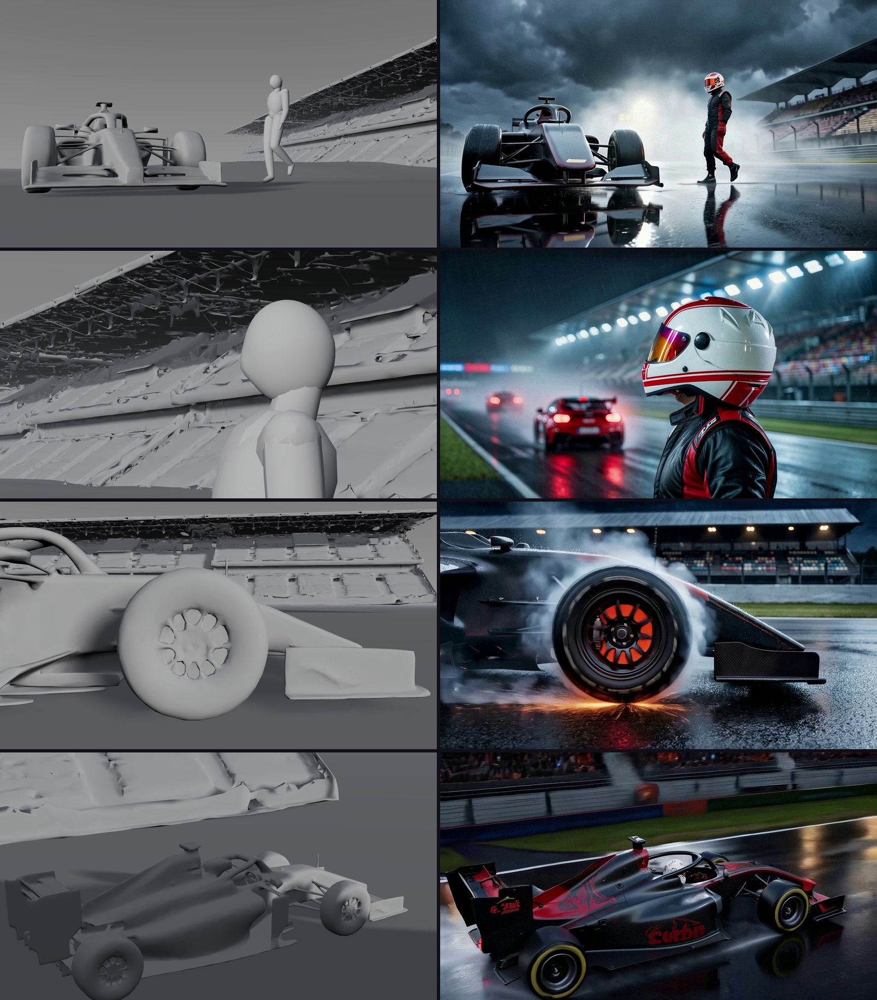

# Canvas Stage

Canvas Stage is a browser app for filming a 3D set. You describe a scene in words; the app builds it as real 3D geometry
(a set, props, one motion-captured performer), and you film it with a camera you fly yourself, with the keyboard or a
DualSense controller. A take is a few seconds of grey clay video made in the browser. LTX-2.5 with Lightricks'
Layout-To-Render LoRA then turns the clay into footage, using an approved still as the look. The same person and the same
world hold from every angle because they are geometry, not a new generation per shot. Lightricks built the renderer; this
app is the set it films and the operator who films it.



*Left, the clay take filmed in the browser; right, the same take rendered. Four shots from the demo: walk-up, helmet close-up,
wheel burnout, aerial straight.*

**▶ [Watch the demo video](https://www.youtube.com/watch?v=7GTeOBjMs6U)**: the finished shots, then a walkthrough of the app.

Entry for Comfy's "Open Source Higgsfield" contest. **All footage made with Canvas Stage is AI-generated.**
Every model the app uses is open weights; there are no partner (closed API) nodes and no hosted LLM.

> **Status: beta.** Canvas Stage was built in ten days for the contest. The core works end to end: build a set from
> words, fly a camera through it, and render photographic footage that holds the same person and place from every angle.
> The interface is still rough in places, and some panels show more of the machinery than they should. We intend to keep
> improving it — simpler prompt controls, a lighter Stage, and better ways to keep shots consistent — and pull requests
> and issues are welcome. See [CONTRIBUTING.md](CONTRIBUTING.md).

New here? [docs/GUIDE.md](docs/GUIDE.md) walks through your first shot step by step, with tips for good results.
Setting this up with an AI coding agent? Point it at [AGENTS.md](AGENTS.md).

**Prizes we claim:** Open Weights Only, and the VFX Workflow Built with LTX prize (LTX-2.5 with Layout-To-Render is the only video model). We do not claim the FLUX or MiniMax bonus prizes: FLUX.2 Klein 4B only finishes a still, and no MiniMax model is used.

## Try it free: no key, no GPU

Install the app and the sample scene (below), open Home and click the sample, an open-wheel race car on a wet track at night with a
performer beside it. You can look around, switch between Free view, Top View and the Camera view, fly the camera and press
Controls to see every key and button. Nothing on that path calls a paid service, and every paid button shows its price
before you press it (and is refused while no day budget is set).

```bash
cd app && npm ci && cd ..
node scripts/install-sample.mjs      # copies the sample scene into the app's scene data
cd app && npm run dev                # http://localhost:5173
```

Needs Node 22.12 or newer. Open it as `localhost` or `127.0.0.1`: the server refuses paid requests from any other origin.
Recording a take also needs ffmpeg and Python (see [SETUP.md](SETUP.md)); looking around does not. The sample is about
3 MB (`sample/night-circuit/`) and is a scrubbed copy: no credit records or job ids.

## How a scene goes

The tab bar is **Home, Stage, Render, Export**.

| Where | What happens | Cost |
|---|---|---|
| Home | One box. Write the scene or paste a prompt, then **Develop** (a small model writes the people, props and place) or **Use my words as they are** | Develop about 4 cr; using your words is free |
| Stage, first words | A scene with a set but no words opens a card, "Describe your scene". Write there, then Continue | free |
| Stage, setup | Lists the people and props Develop found. **Build the set** lays the 3D set out in code | about 4 cr |
| Stage, the subject | Make the performer's look: Generate looks (1 to 4), pick one, Use this look | a few cr per look |
| Stage, props | Right-click empty ground, Add a prop or set piece; generate or upload a picture, place it, it builds in 3D once | a few cr per prop |
| Stage, camera | Pick a preset move (push in, pull out, pan, orbit, crane, hold; 2, 4 or 8 s) or fly the camera yourself and record. Lock a take | free |
| Stage, draw | Draw the first frame from the take card beside the Prompt box, held to the 3D depth. Its window (click the picture) holds Clay / Still, Edit this frame, the versions (the one you click is the frame in use) and Render clip | about 21 to 39 cr |
| Render | Render clip, in the first frame's window: the clay video plus the frame in use through LTX-2.5 and Layout-To-Render, then a free local finish (grade, sharpen, grain). The Render tab plays it | about 16 to 30 cr for 2 to 4 s |
| Export | Download the finished clip | free |

**Right-click menus.** Right-click the person (Walk to a spot, Slow walk, Run, Hold here, Edit look), a piece (Move to a
spot, Edit look, Duplicate, Remove) or empty ground (Add a prop or a set piece).

**Flying the camera.** Keyboard: WASD to move, Q and E down and up, arrows or the mouse to aim, Z and X or the wheel to
zoom, R to record, T for a still, Space to play, 1 to 5 to change rig. DualSense: left stick moves, right stick aims, L2 and
R2 zoom, Square records. The **Controls** button beside the view switch shows the full table.

Money is guarded on the server: every paid press shows its price first, spends against a per-day budget
(`CANVAS_DAY_BUDGET`) and is recorded before it waits. Paid jobs survive leaving the screen or reloading, and are never
paid twice. Prices here are estimates from the app on 2026-10-28; the button on your screen is the truth.

## Writing a shot prompt

Your words go to the models as you wrote them. The app adds nothing you can't see: before Draw the first frame and
Render clip, "What will be sent" shows every job's exact words, the negative included.

- **Tags become their card.** An @tag is replaced once, where you typed it, by that person's or prop's description
  ("@ana walks to @van" becomes "a woman in a green raincoat walks to a dented white delivery van"). Later mentions read
  by name. Write the sentence so it still reads well with the description in it.
- **The camera comes from the clay.** The clay video carries the exact move you recorded, so nothing about the camera is
  added for you. Describe the move if you like ("the camera circles her"), and keep it true to what you filmed.
- **Give an orbit something to turn against.** Name distant set pieces and ground marks (a grandstand, a white line, a
  row of trees) so the background moves the way the camera does.
- **The draw also gets the Stage's layout.** It adds the figure's size and place, the angle, the lens feel and the pieces
  in view, all shown in the sent text.

Per model, from the vendors' own guides:

- **Qwen-Image 2512 (the first frame).** Describe the whole picture in plain prose, not a list: who, what they wear,
  their pose, the place, the light (its direction and colour) and the surfaces. Around 200 words is plenty, less for a
  simple scene. Skip quality tags such as "4K".
- **FLUX.2 Klein (the finish and edits).** One instruction: say what changes and what stays. Edit this frame takes one
  change at a time, in plain words ("make the car silver").
- **LTX-2.5 with Layout-To-Render (the clip).** Short: one or two sentences of what happens, in order, then the look.
  Don't write "clay", "3D" or "Unreal". Show feelings through posture and gesture, keep one light source, and leave
  out signs and logos.

## What runs where

| Piece | Runs on | Cost |
|---|---|---|
| The app, the 3D Stage, the performer, the clay video, the Render finish, export | your machine (Node, ffmpeg, Python) | free |
| The planner, looks, stills and Render (the Comfy graphs below) | Comfy Cloud with your API key, or your own ComfyUI on a GPU box | Cloud bills credits (about 211 per US dollar). Your own ComfyUI costs nothing per job, but the full chain is untested there and LTX-2.5 22B needs a very large GPU |
| New moves from words (optional) | the motion service in `motionbox/`, on a CUDA Linux machine you run yourself; the app reaches it over an SSH port-forward | free once running; without it the ready-made moves still work |

The free tour needs none of the second and third rows. A first scene taken through to one rendered take is roughly 100 to
150 credits on Cloud.

## Status and limits

Works end to end in the app on Comfy Cloud: sentence, Develop, Build the set, the person's look, camera, Draw, Render,
Export. Plainly:

- Sets are built from a fixed kit of piece types, mostly exterior. The app flags what the kit cannot build (vehicles it has
  no piece for, horses and riders, water, animals) and suggests a swap. Kit silhouettes can still read as clay in footage.
- The performer's moves come from a small mocap library (walk, run, idle, turn, look, kneel) plus the optional motion
  service. There is no general text-to-motion.
- The planner sometimes needs a second try; the app retries once by itself. One Comfy job runs at a time.
- A local dev-server app: localhost only, no accounts, your own key.

## Quick start (paid path)

Follow [SETUP.md](SETUP.md), Part B: one ordered checklist, with `npm run preflight` (a free check, no credits) and
`node scripts/import-lora.mjs` (the one-time LoRA import). About 20 minutes and about 150 credits to one rendered take.
Other commands in `app/`: `npm run build` (typecheck and build), `npm run lint`, `npx vitest run` (never loads your key, cannot bill).

## Connecting to Comfy

**Privacy:** there are no accounts, no telemetry and no hosted LLM; your scenes, takes and renders stay on your machine, and the
only thing that leaves it is a paid job you press, sent to Comfy Cloud (or your own ComfyUI). The browser never talks to Comfy and never sees your key. The dev server reads `app/.env` and submits the graphs through the
official TypeScript SDK (`@comfyorg/sdk`, Comfy API v2).

**Comfy Cloud** (what the app is built and tested on): set `COMFY_API_KEY`, leave `COMFY_BASE_URL` empty. API access needs a
paid plan; the project was built on Creator, which also allows importing Hugging Face LoRAs.

**Your own ComfyUI:** the API-format graphs in `app/workflows/` load in any ComfyUI that has the models and nodes, and the
app has a self-hosted mode (`COMFY_BASE_URL` pointing at a `comfy-api-proxy`, see [app/scripts/README.md](app/scripts/README.md)).
Nobody has run the whole chain this way; use Cloud to try the app. The planner needs a ComfyUI recent enough to have the
core `TextGenerate` node.

### One-time import: the Layout-To-Render LoRA (Cloud)

Render needs Lightricks' Layout-To-Render IC-LoRA, a gated, per-account import. Run `node scripts/import-lora.mjs`
once ([SETUP.md](SETUP.md), step 5, including the by-hand curl and PowerShell versions). Everything before Render works without it.

## Environment

All in `app/.env` (copy `app/.env.example`, which lists exactly what the app reads). Restart the dev server after changes.

| Variable | Needed | What it does |
|---|---|---|
| `COMFY_API_KEY` | for paid steps (Cloud) | Your Comfy Cloud API key. Server-side only, never committed (`.env` is git-ignored) |
| `CANVAS_DAY_BUDGET` | for paid steps | Credits the app may spend per local day. Set `300`: one scene to one rendered take is about 150. **Unset or 0 refuses every paid press** (by design). Persisted on disk, resets at midnight |
| `CANVAS_PYTHON` | no | Full path to the app's one Python (a venv's `python`). Unset = `python` on PATH. `python app/scripts/check_python.py` lists what imports |
| `CANVAS_L2R_LORA` | no | The LoRA's name in your account if it is not the default |
| `COMFY_BASE_URL`, `COMFYUI_URL` | no | Leave empty for Cloud. Only for the untested self-hosted mode |
| `MOTION_BOX_URL`, `MOTION_BOX_TOKEN` | no | The motion service's address (an SSH port-forward) and shared secret; see SETUP |
| `CLAY_KEEP_FRAMES` | no | `1` keeps a take's raw clay frames for debugging |

## Workflow files

API-format snapshots of the graphs the server builds and sends, in `app/workflows/` (a unit test fails if they
drift from the code). Prompts and seeds are placeholders; the app fills them per job.

| File | Used for | Models |
|---|---|---|
| `planner_gemma4-e4b` | Develop and the scene plan | Gemma 4 E4B (fp8) via core `TextGenerate` |
| `concept_qwen2512` | Prop and look pictures, Full | Qwen-Image 2512 (fp8), Qwen2.5-VL 7B encoder, Qwen image VAE |
| `concept_qwen2512-lightning` | Prop and look pictures, Draft | as above + Qwen-Image 2512 Lightning 4-step LoRA |
| `cast_front_zit` | Cast front cards | Z-Image Turbo (bf16), Qwen3 4B encoder, `ae` VAE |
| `hero_qwen2512-union-depth` | Draw (the opening still), held to the set's depth | Qwen-Image 2512 + Qwen-Image 2512 Fun ControlNet Union |
| `hero_klein4b-finish` | Draw finish (face and costume, the person's look as reference) | FLUX.2 Klein 4B, Qwen3 4B encoder, FLUX.2 VAE |
| `l2r_layout-to-render` | Render | LTX-2.5 22B distilled (bf16), Layout-To-Render IC-LoRA, Gemma 4 12B encoder with LTX-2.5 projection, LTX-2.5 VAE, latent spatial upscaler x2 |
| `l2r_layout-to-render-keyframes` | Render with mid / end keyframe stills | as above |

This public repo ships only these 8 graphs, the ones the app sends. Other experiment graphs and notes are not part of this repository.

## Models and licences

Only what the app's graphs and scripts load today. Nothing is bundled: Comfy Cloud hosts the weights (or you download them).
Licences were checked on 2026-10-29 against each model card on Hugging Face or the vendor's licence text. Rows say "not traced" where the exact repacked file could not be matched to a repository.

| Model | Used for | Source | Licence |
|---|---|---|---|
| LTX-2.5 22B distilled, video VAE, latent spatial upscaler x2 (Lightricks) | Render | Lightricks on Hugging Face (gated, accept the terms) | LTX-2.x Community License Agreement (2026-08-11): free for any lawful use below US$10M annual revenue (affiliates counted), a paid licence from Lightricks at or above it; generated output must be disclosed as machine-generated; watermark and provenance features must not be removed |
| LTX-2.5 Layout-To-Render IC-LoRA (Lightricks) | Render | Lightricks on Hugging Face (gated) | LTX-2.x Community License Agreement (same terms; card links the same text) |
| Gemma 4 12B encoder with LTX-2.5 projection (Comfy repack, hosted in the LTX-2.5 repository) | Render prompts | Lightricks on Hugging Face (gated) | LTX-2.x Community License Agreement for the file; the base Gemma 4 12B is Apache-2.0 |
| Gemma 4 E4B instruct fp8 (Google, Comfy repack) | Planner | Comfy-Org on Hugging Face | Apache-2.0 (card) |
| Qwen-Image 2512, Qwen2.5-VL 7B encoder, Qwen image VAE (Alibaba Qwen) | Draw, look pictures | Qwen and Comfy-Org on Hugging Face | Apache-2.0 (cards) |
| Qwen-Image 2512 Lightning 4-step LoRA | Draft pictures | Lightx2v on Hugging Face | Apache-2.0 (card) |
| Qwen-Image 2512 Fun ControlNet Union 2602 | Draw depth lock | alibaba-pai on Hugging Face | Apache-2.0 (card) |
| Qwen-Image-Edit 2511 (bf16) + Lightning 8-step LoRA | Stills edit, frame edit | Qwen / Lightx2v on Hugging Face | Apache-2.0 (cards) |
| FLUX.2 Klein 4B, FLUX.2 VAE (Black Forest Labs), Qwen3 4B encoder | Hero finish, face redraw | Black Forest Labs and Comfy-Org on Hugging Face | Apache-2.0 (cards). Klein 9B and FLUX.2 dev are non-commercial and appear only in experiment graphs not shipped here |
| Z-Image Turbo, Qwen3 4B encoder, VAE (Tongyi-MAI) | Cast cards | Tongyi-MAI and Comfy-Org on Hugging Face | Apache-2.0 (cards) |
| TRELLIS.2 (shape, int8), BiRefNet | Build in 3D (generated set pieces) | Microsoft and Comfy-Org on Hugging Face | MIT (cards). BiRefNet: exact Comfy-hosted file not traced to its repository; the BiRefNet card is MIT |
| DINOv3 ViT-L (NAF variant) | Build in 3D (conditioning) | Comfy Cloud model library | Meta DINOv3 License (commercial use allowed, agreement attached to redistribution; not redistributed here). The NAF upsampler is Apache-2.0. Exact file not traced to its repository |
| YuNet face detector (OpenCV Zoo) | Face detail pass | shipped in `app/scripts/clay/models/` | MIT (full text beside it) |

The optional command-line script `app/scripts/lift-performance.ts` also loads MoGe-2 (MIT) and SAM 2.1 (Apache-2.0) on your own GPU; the app does not call it.

The LTX-2.x Community License (full text in [LICENSES/LTX-2-Community-License.txt](LICENSES/LTX-2-Community-License.txt)) asks that machine-generated output be disclosed as such; hence the AI-generated line above. Do not strip metadata from exported clips; the licence forbids removing provenance features.
Every model the app uses runs on Comfy Cloud (or your own ComfyUI); the only model that runs on your machine is the small YuNet face detector shipped in the repository.

The motion box (SETUP, "The motion box") runs outside the app: generated moves: NVIDIA Kimodo (Apache-2.0 code, Kimodo-SOMA-RP-v1 weights under the NVIDIA Open
Model License). Text encoder: Meta Llama 3 8B Instruct, Built with Meta Llama 3, used under the Meta Llama 3 Community
License. Kimodo's licence does not claim ownership of outputs; the Llama licence restricts using outputs to improve another AI
model, which this app does not do (the embeddings only steer generation at run time). The Llama weights are gated: the box's
setup asks you to request access yourself, and downloads from the official Meta repository by default.

**Motion capture.** The performer's clips are from the CMU Graphics Lab Motion Capture Database
(http://mocap.cs.cmu.edu), BVH conversion via github.com/una-dinosauria/cmu-mocap, shipped in `app/public/mocap/cmu/`.
"The data used in this project was obtained from mocap.cs.cmu.edu. The database was created with funding from NSF
EIA-0196217." See their terms for use.

**Licences and non-commercial models.** This public repo ships only the 8 workflow graphs the app sends (the Workflow files table); other experiment graphs and notes are not part of this repository. Model weights are never included in this repository.

Third-party notices are in [NOTICE](NOTICE).


## Licence

The code in this repository is MIT licensed, copyright 2026 Zachary Ahern ([LICENSE](LICENSE)). Models, the mocap data and
npm dependencies keep their own licences.

## More

[docs/GUIDE.md](docs/GUIDE.md) is the user guide; [docs/comfy-integration.md](docs/comfy-integration.md) explains how the app talks to Comfy.
